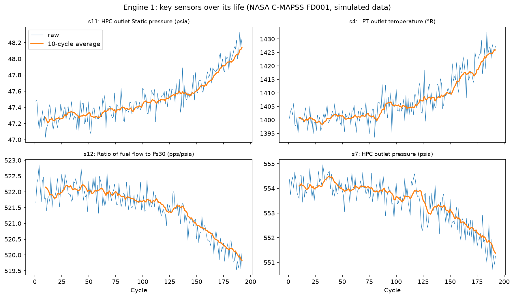
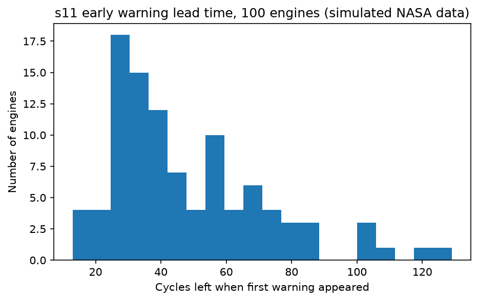

# Predictive Maintenance: Early-Warning Analysis of Jet Engine Sensor Data

Python analysis of NASA C-MAPSS turbofan engine sensor data (subset FD001) to see which sensors drift as an engine wears out, and how early a simple rule can warn.

## Data
- NASA C-MAPSS turbofan engine degradation dataset, subset FD001: 100 engines, 20,631 rows, 21 sensors, run until failure.
- The data is simulated by NASA, not recorded from real engines.
- I used a CSV copy on Kaggle: "NASA Turbofan Jet Engine Dataset CSV" by Azmain Adeeb, https://www.kaggle.com/datasets/azmaininqiadadeeb/nasa-turbofan-jet-engine-dataset-csv
- Licence: MIT License (as shown on the Kaggle page)
- The raw data is not included here; download it from the link above.

## Question
Which sensors change as an engine approaches failure, and how many cycles of notice can a simple threshold rule give?

## Tools
Python (Pandas, NumPy, Matplotlib), Jupyter Notebook

## What I did
- Checked data quality: no missing values, no duplicates, 100 engines. Confirmed that the remaining useful life (RUL) column equals the engine's last cycle minus the current cycle.
- Removed sensors that never change (s1, s5, s10, s16, s18, s19) and one that barely changes (s6).
- Calculated the correlation of each remaining sensor with RUL and picked the four strongest: s11 (HPC outlet static pressure), s4 (LPT outlet temperature), s12 (ratio of fuel flow to Ps30) and s7 (HPC outlet pressure).
- Plotted these sensors over the life of one engine, with a 10-cycle rolling average.
- Built an early-warning rule: take each engine's first 30 cycles as its healthy baseline, then raise a warning when the 10-cycle average of a sensor moves more than 3 standard deviations from that baseline in the direction of wear.
- Applied the rule to all 100 engines and measured how many cycles of life were left when the first warning appeared.

## Key findings
- s11 and s4 rise and s12 and s7 fall as engines approach failure; the drift speeds up in the last part of the engine's life.
- The rule gave a warning for all 100 engines. Median cycles left at the first warning: s11 40.5, s12 40.0, s7 36.0, s4 35.0.
- s11 was the most useful: even in the worst 10% of engines it still gave about 25 cycles of notice (s7 gave under 11).
- A typical engine in this data lasts about 200 cycles (median 199), so 40 cycles is roughly the last fifth of its life.
 For s11, the earliest warning came 129 cycles before failure, and the median warning came when 22.8 % of the engine's life was left.

## Charts

## Limitations
- All engines in the data run to failure, so I could not test for false alarms on healthy engines.
- The first 30 cycles are assumed to be healthy; this is an assumption.
- The rule is a simple threshold, not a prediction model, and the settings (30-cycle baseline, 10-cycle average, 3 standard deviations) were chosen by me and not tuned.
- I only used subset FD001, which has one operating condition and one failure type.
- The data is simulated, so results may not hold for real engines.

## Files
- notebooks/ : analysis notebook
- images/ : charts